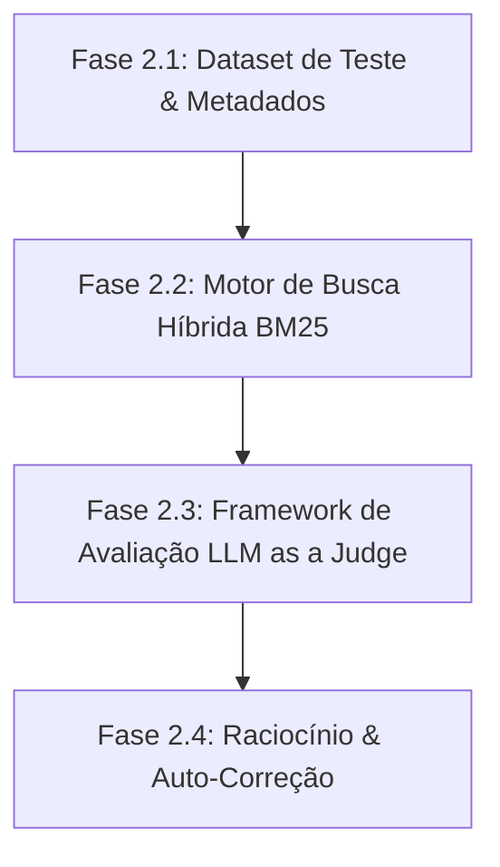

# 🗺️ Roadmap de Implantação — Fase 2: RAG Avançado & Avaliação Corporativa

> **Guia passo a passo auto-contido para evolução da arquitetura do KnowledgeHub AI para um RAG de nível Production-Grade.**

---

## 📌 Visão Geral da Fase 2

A **Fase 1 (MVP)** entregou um monólito modular com pipeline RAG vetorial completo (PyMuPDF, ChromaDB, `multilingual-e5-large`, FastAPI e Streamlit) com rastreabilidade de evidências.

A **Fase 2** foca na transição para um **RAG Avançado e Avaliável**, resolvendo os principais gargalos da busca puramente vetorial:
1. **Perda de precisão semântica em códigos e termos exatos** (resolvido via Busca Híbrida BM25).
2. **Ruído informacional de outros departamentos** (resolvido via Filtros Dinâmicos por Metadados).
3. **Falta de métricas quantitativas de alucinação e qualidade** (resolvido via *LLM as a Judge* e *Ragas*).
4. **Respostas em casos onde o contexto é insuficiente** (resolvido via Auto-Correção e Fallback).

---

## 🚀 Fases de Execução & Checklist Técnico



---

### 🟢 Fase 2.1: Estruturação de Metadados & Dataset de Teste (Gold Standard)

**Objetivo:** Estabelecer a base de validação empírica antes de alterar os motores de busca.

#### 📝 Tarefas:
1. **Enriquecimento de Metadados na Ingestão:**
   * Atualizar a pipeline de ingestão (`backend/ingest.py`) para extrair e indexar no ChromaDB os campos de metadados:
     * `department`: derivado da sigla do arquivo (ex.: `COM` -> Compras, `FIN` -> Financeiro, `JUR` -> Jurídico, `PRD` -> Produção, `QUA` -> Qualidade).
     * `doc_code`: código do documento (ex.: `COM-001`).
     * `page_number`: número da página extraído via PyMuPDF.

2. **Criação do Dataset de Teste Ouro (`tests/gold_dataset.json`):**
   * Criar um arquivo de validação estática contendo de 20 a 30 pares de **Pergunta**, **Resposta Esperada** e **Chunks de Referência**, cobrindo:
     * Perguntas conceituais de processos.
     * Perguntas sobre prazos e valores (ex: reembolsos em `FIN-001`).
     * Perguntas com termos e códigos exatos.

---

### 🟢 Fase 2.2: Implementação da Busca Híbrida (Dense + Sparse / BM25)

**Objetivo:** Combinar a busca semântica (embeddings) com a busca lexical por palavras-chave (BM25) para maximizar a precisão da recuperação.

#### 📝 Tarefas:
1. **Adicionar Dependência do Algoritmo BM25:**
   * Adicionar `rank-bm25` ao `backend/requirements.txt`.

2. **Construção da Camada de Indexação Esparsa (`backend/app/services/bm25_search.py`):**
   * Implementar o fatiamento e tokenização de palavras-chave dos mesmos chunks inseridos no ChromaDB.
   * Criar um índice BM25 em memória inicializado durante a carga do servidor ou ingestão.

3. **Fusão de Resultados (Reciprocal Rank Fusion - RRF):**
   * Implementar a função de reordenamento em `backend/app/services/retrieval.py`:
     $$\text{RRF\_Score}(d) = \sum_{m \in M} \frac{1}{k + r_m(d)}$$
     onde $k = 60$, fundindo os Top-K resultados do ChromaDB com os Top-K do BM25.

4. **Filtragem Dinâmica por Metadados:**
   * Expor parâmetro de filtro opcional na API FastAPI (`/api/v1/query`) para aceitar `department` e aplicar a cláusula `where={"department": dept}` no ChromaDB e no BM25.

---

### 🟢 Fase 2.3: Framework de Avaliação Automatizada (*LLM as a Judge*)

**Objetivo:** Medir quantitativamente a qualidade da recuperação e da resposta sem testes manuais.

#### 📝 Tarefas:
1. **Métricas Principais a Avaliar:**
   * **Context Precision:** A recuperação trouxe os chunks corretos?
   * **Faithfulness (Fidelidade):** A resposta gerada pela LLM fundamenta-se estritamente nos chunks fornecidos (sem alucinações)?
   * **Answer Relevance:** A resposta atende diretamente à dúvida do usuário?

2. **Criação da Suite de Avaliação (`scripts/evaluate_rag.py`):**
   * Implementar script de execução batch que roda as perguntas do `gold_dataset.json` contra a API RAG.
   * Enviar a tripla *(Pergunta, Contexto Recuperado, Resposta Gerada)* para a LLM (Google Gemini) com prompt avaliador configurado para retornar notas de 0 a 1 e justificativas em formato JSON.

3. **Painel de Resultados de Avaliação:**
   * Salvar relatórios de avaliação em `backend/data/eval_reports/` para comparação entre versões de prompt e algoritmos.

---

### 🟢 Fase 2.4: Raciocínio, Fallback e Auto-Correção (Self-Corrective RAG)

**Objetivo:** Evitar alucinações quando o contexto recuperado for insuficiente ou irrelevante.

#### 📝 Tarefas:
1. **Validação de Limiar de Similaridade (Score Threshold):**
   * Se o score de relevância combinado (RRF) dos chunks recuperados for inferior a um limiar aceitável (ex: $< 0.35$), acionar fluxo de Fallback.

2. **Estratégia de Guardrails e Resposta Segura:**
   * Caso o contexto não contenha evidências suficientes, instruir a LLM via prompt a responder explicitamente:  
     *"Não foi possível localizar essa informação nas políticas e manuais internos da empresa."*
   * Impedir a geração de suposições baseadas em conhecimento geral da LLM.

---

## 📊 Matriz de Comparação de Arquitetura

| Funcionalidade | Fase 1 (MVP Atual) | Fase 2 (Evolução RAG) |
| :--- | :--- | :--- |
| **Recuperação** | Busca Vetorial Pura (ChromaDB) | **Busca Híbrida (ChromaDB + BM25 via RRF)** |
| **Metadados** | Rastreabilidade básica (Arquivo/Página) | **Filtros por Departamento e Código de Documento** |
| **Avaliação** | Validação manual end-to-end | **Avaliação Automatizada (LLM as a Judge / Ragas)** |
| **Tratamento de Falhas** | Prompt Grounding simples | **Limiar de Relevância + Auto-Correção + Guardrails** |

---

## 🛠️ Guia de Implementação Rápida

Para iniciar a execução dos trabalhos da Fase 2, siga a ordem dos módulos abaixo:

```bash
# 1. Instalar a nova dependência de busca esparsa
pip install rank-bm25

# 2. Executar novo script de re-indexação com metadados expandidos
python backend/ingest.py --enrich-metadata

# 3. Rodar a suite de avaliação inicial (Baseline)
python scripts/evaluate_rag.py
```