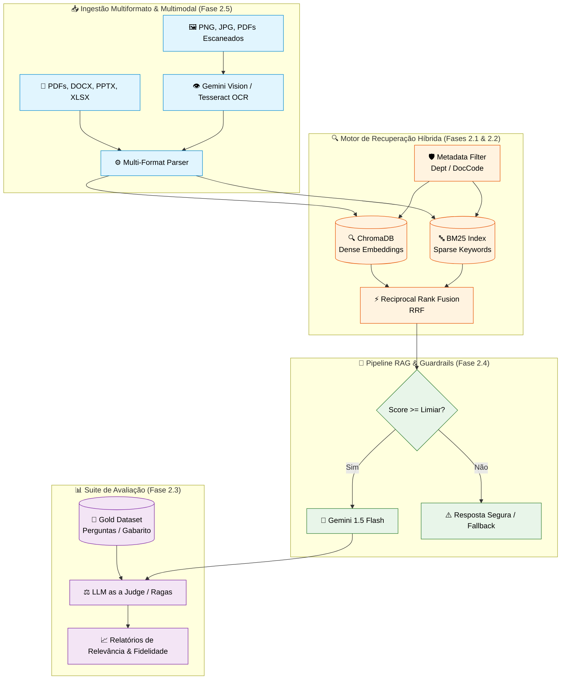

# 🗺️ Roadmap de Implantação — Fase 2: RAG Avançado, Multimodal & Avaliação Corporativa

> **Especificação Técnica e Guia de Implementação Auto-contido para a evolução da arquitetura do KnowledgeHub AI para Production-Grade.**

---

## 📌 Visão Geral da Fase 2

A **Fase 1 (MVP)** entregou um monólito modular com pipeline RAG vetorial completo (PyMuPDF, ChromaDB, `multilingual-e5-large`, FastAPI e Streamlit) com rastreabilidade de evidências.

A **Fase 2** expande os limites do sistema tratando 5 grandes pilares:

1. **Perda de precisão em termos exatos e siglas** $\rightarrow$ Busca Híbrida (Dense + Sparse / BM25) com fusão via RRF.
2. **Ruído de contexto interdepartamental** $\rightarrow$ Filtros dinâmicos por metadados de departamento.
3. **Falta de métricas quantitativas de qualidade** $\rightarrow$ Framework de Avaliação Automatizada (*LLM as a Judge*).
4. **Respostas inconsistentes sem contexto** $\rightarrow$ Guardrails, Limiares de Relevância e Auto-Correção.
5. **Restrição a PDFs textuais** $\rightarrow$ Ingestão Multiformato (`.docx`, `.pptx`, `.xlsx`) e RAG Multimodal/OCR (`.png`, `.jpg`, PDFs escaneados).

---

## 🏗️ Arquitetura da Fase 2



---

## 🚀 Detalhamento Técnico das Fases de Implementação

---

### 🟢 Fase 2.1: Estruturação de Metadados & Dataset de Teste (Gold Standard)

#### 🎯 Objetivo
Garantir o enriquecimento de metadados em todos os chunks e criar o conjunto de teste de referência (*Gold Dataset*) para validar o sistema quantitativamente.

#### 🔧 Como Implementar:

1. **Atualização do Modelo de Ingestão (`backend/app/schemas/document.py` e `backend/ingest.py`):**
   Garantir a inclusão de metadados durante a criação dos vetores:
   ```python
   metadata = {
       "source": file_name,
       "department": file_name.split("-")[0],  # Ex: 'COM' -> Compras
       "doc_code": file_name.split(".")[0],    # Ex: 'COM-001'
       "page_number": page_num,
       "file_type": file_extension
   }
   ```

2. **Criação do Dataset Ouro (`tests/gold_dataset.json`):**
   Estruturar um JSON com 25 a 30 perguntas representativas contendo o gabarito de respostas e trechos esperados:
   ```json
   [
     {
       "id": "q1",
       "question": "Qual o prazo limite para prestação de contas de reembolso viagem?",
       "expected_answer": "O prazo limite para prestação de contas é de 5 dias úteis após o término da viagem.",
       "expected_doc_code": "FIN-001",
       "expected_department": "FIN"
     }
   ]
   ```

---

### 🟢 Fase 2.2: Busca Híbrida (Dense + Sparse / BM25) com RRF

#### 🎯 Objetivo
Unir a precisão semântica (ChromaDB + embeddings) com a precisão por palavras-chave exatas (BM25) para tratar buscas por siglas, termos de leis e códigos de documentos.

#### 🔧 Como Implementar:

1. **Instalar Dependência:**
   ```bash
   pip install rank-bm25
   ```

2. **Criar Módulo BM25 (`backend/app/services/bm25_service.py`):**
   ```python
   from rank_bm25 import BM25Okapi
   import re

   class BM25SearchService:
       def __init__(self):
           self.corpus = []
           self.doc_ids = []
           self.bm25 = None

       def tokenize(self, text: str):
           return re.findall(r'\w+', text.lower())

       def index_documents(self, documents: list[dict]):
           """Indexa lista de dicts com 'id' e 'content'."""
           self.doc_ids = [doc['id'] for doc in documents]
           self.corpus = [doc['content'] for doc in documents]
           tokenized_corpus = [self.tokenize(text) for text in self.corpus]
           self.bm25 = BM25Okapi(tokenized_corpus)

       def search(self, query: str, top_k: int = 10) -> list[tuple[str, float]]:
           tokenized_query = self.tokenize(query)
           scores = self.bm25.get_scores(tokenized_query)
           ranked_indices = sorted(range(len(scores)), key=lambda i: scores[i], reverse=True)[:top_k]
           return [(self.doc_ids[i], float(scores[i])) for i in ranked_indices]
   ```

3. **Fusão por Reciprocal Rank Fusion (`backend/app/services/hybrid_retrieval.py`):**
   Combinar os rankings Dense (ChromaDB) e Sparse (BM25) pela fórmula RRF ($k=60$):

   $$
   \text{RRF\_Score}(d) = \sum_{m \in M} \frac{1}{k + r_m(d)}
   $$

   ```python
   def reciprocal_rank_fusion(dense_ranks: list[str], sparse_ranks: list[str], k: int = 60, top_n: int = 5):
       scores = {}
       
       for rank, doc_id in enumerate(dense_ranks):
           scores[doc_id] = scores.get(doc_id, 0) + 1.0 / (k + rank + 1)
           
       for rank, doc_id in enumerate(sparse_ranks):
           scores[doc_id] = scores.get(doc_id, 0) + 1.0 / (k + rank + 1)

       sorted_docs = sorted(scores.items(), key=lambda item: item[1], reverse=True)
       return sorted_docs[:top_n]
   ```

---

### 🟢 Fase 2.3: Framework de Avaliação Automatizada (*LLM as a Judge*)

#### 🎯 Objetivo
Avaliar quantitativamente as métricas de **Faithfulness** (Fidelidade), **Context Precision** (Precisão de Recuperação) e **Answer Relevance** (Relevância da Resposta).

#### 🔧 Como Implementar:

1. **Criar Script de Avaliação (`scripts/evaluate_rag.py`):**
   Utilizar a LLM Gemini em modo JSON estruturado como juiz do pipeline RAG:
   ```python
   import json
   import google.generativeai as genai

   PROMPT_JUDGE = """
   Você é um avaliador especialista em sistemas RAG corporativos.
   Avalie a resposta gerada com base na pergunta e no contexto fornecido.

   Pergunta: {question}
   Contexto Recuperado: {context}
   Resposta Gerada: {answer}

   Retorne um JSON com a seguinte estrutura:
   {{
       "faithfulness_score": <float de 0.0 a 1.0>,
       "answer_relevance_score": <float de 0.0 a 1.0>,
       "justification": "<explicação suscinta>"
   }}
   """

   def evaluate_response(question: str, context: str, answer: str) -> dict:
       model = genai.GenerativeModel("gemini-1.5-flash")
       prompt = PROMPT_JUDGE.format(question=question, context=context, answer=answer)
       response = model.generate_content(
           prompt,
           generation_config={"response_mime_type": "application/json"}
       )
       return json.loads(response.text)
   ```

---

### 🟢 Fase 2.4: Raciocínio, Fallback e Auto-Correção (Self-Corrective RAG)

#### 🎯 Objetivo
Prevenir alucinações quando os documentos recuperados forem irrelevantes ou de baixa similaridade.

#### 🔧 Como Implementar:

1. **Adicionar Limiar de Relevância (Score Thresholding):**
   No serviço RAG (`backend/app/services/rag_service.py`):
   ```python
   SCORE_THRESHOLD = 0.015  # Limiar mínimo RRF para considerar o contexto válido

   def generate_rag_response(query: str, department: str = None):
       docs = hybrid_search(query, department=department)
       max_score = docs[0]['rrf_score'] if docs else 0.0

       if max_score < SCORE_THRESHOLD:
           return {
               "answer": "Não foi possível localizar essa informação nas políticas e manuais internos da empresa.",
               "sources": [],
               "fallback_triggered": True
           }
       
       # Caso contrário, executa o prompt grounding padrão com Gemini
       ...
   ```

---

### 🟢 Fase 2.5: Ingestão Multiformato & RAG Multimodal (Visão & OCR)

#### 🎯 Objetivo
Permitir a leitura nativa de documentos Office (`.docx`, `.pptx`, `.xlsx`) e o fatiamento multimodal de imagens/PDFs escaneados (`.png`, `.jpg`, PDFs sem camada de texto).

#### 🔧 Como Implementar:

1. **Instalar Dependências de Parsing:**
   ```bash
   pip install python-docx python-pptx openpyxl pypdfium2 pillow
   ```

2. **Implementação do Extrator Multiformato (`backend/app/services/parsers.py`):**
   ```python
   from docx import Document
   from pptx import Presentation
   import openpyxl

   def parse_docx(file_path: str) -> str:
       doc = Document(file_path)
       return "\n".join([p.text for p in doc.paragraphs if p.text.strip()])

   def parse_pptx(file_path: str) -> str:
       prs = Presentation(file_path)
       text = []
       for slide in prs.slides:
           for shape in slide.shapes:
               if hasattr(shape, "text"):
                   text.append(shape.text)
       return "\n".join(text)

   def parse_xlsx(file_path: str) -> str:
       wb = openpyxl.load_workbook(file_path, data_only=True)
       text = []
       for sheet in wb.sheetnames:
           ws = wb[sheet]
           for row in ws.iter_rows(values_only=True):
               row_text = " | ".join([str(cell) for cell in row if cell is not None])
               if row_text:
                   text.append(row_text)
       return "\n".join(text)
   ```

3. **Leitura Multimodal de Imagens e Diagramas via Gemini Vision (`backend/app/services/vision_parser.py`):**
   Para arquivos de imagem ou diagramas complexos em PDFs:
   ```python
   import google.generativeai as genai
   from PIL import Image

   def extract_text_from_image(image_path: str) -> str:
       model = genai.GenerativeModel("gemini-1.5-flash")
       img = Image.open(image_path)
       prompt = "Descreva detalhadamente o conteúdo textual, tabelas e diagramas presentes nesta imagem corporativa para indexação em um sistema de busca."
       response = model.generate_content([prompt, img])
       return response.text
   ```

---

## 📊 Matriz Comparativa de Capacidades

| Recurso / Funcionalidade | Fase 1 (MVP Atual) | Fase 2 (Evolução Completa) |
| :--- | :--- | :--- |
| **Arquivos Suportados** | Apenas PDFs textuais (`PyMuPDF`) | **PDFs, DOCX, PPTX, XLSX, PNG, JPG e PDFs Escaneados** |
| **Algoritmo de Recuperação** | Busca Vetorial Pura (ChromaDB) | **Busca Híbrida (Dense ChromaDB + Sparse BM25 via RRF)** |
| **Capacidade Multimodal** | Nenhuma | **Extração de Diagramas/Tabelas via Gemini 1.5 Flash Vision** |
| **Filtro de Contexto** | Busca global | **Filtragem por Metadados (Departamento, Código do Doc)** |
| **Qualidade & Métricas** | Validação manual ad-hoc | **Avaliação Automatizada (LLM as a Judge / Faithfulness)** |
| **Prevenção de Alucinação** | Prompt simples | **Score Thresholding + Guardrails de Fallback** |

---

## 🛠️ Checklist de Execução

- [ ] **2.1.1** Criar `tests/gold_dataset.json` com 25+ pares de pergunta e resposta.
- [ ] **2.1.2** Atualizar `backend/ingest.py` para injetar `department` e `doc_code` no ChromaDB.
- [ ] **2.2.1** Instalar `rank-bm25` e criar `backend/app/services/bm25_service.py`.
- [ ] **2.2.2** Implementar a fusão RRF em `backend/app/services/hybrid_retrieval.py`.
- [ ] **2.3.1** Desenvolver script de avaliação `scripts/evaluate_rag.py` usando a LLM Gemini.
- [ ] **2.4.1** Adicionar verificação de `SCORE_THRESHOLD` com resposta segura de fallback.
- [ ] **2.5.1** Instalar `python-docx`, `python-pptx`, `openpyxl`, `Pillow`.
- [ ] **2.5.2** Criar os parsers multiformato em `backend/app/services/parsers.py`.
- [ ] **2.5.3** Criar o extrator multimodal de imagens em `backend/app/services/vision_parser.py`.